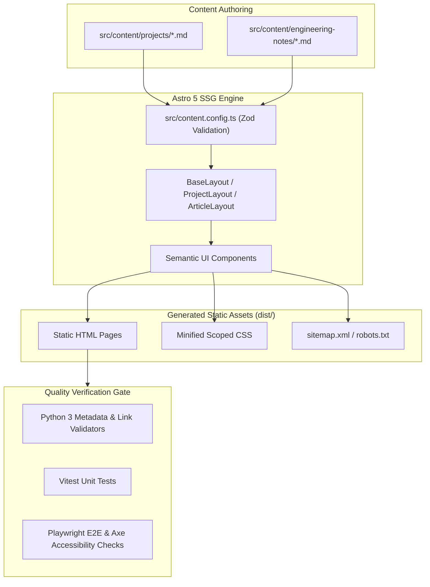

# System Architecture: Senior SDET Engineering Portfolio

## 1. High-Level Architecture Overview

The portfolio is designed as a **zero-runtime-overhead static application** leveraging Astro 5's Content Layer API. Content is authored in Markdown/MDX with strict compile-time Zod schemas, styled with scoped CSS and CSS custom properties (design tokens), and verified using an SDET-grade automated testing pyramid.



---

## 2. Technology Stack & Justification

| Technology                          | Role                        | Justification                                                                                                                                                 |
| ----------------------------------- | --------------------------- | ------------------------------------------------------------------------------------------------------------------------------------------------------------- |
| **Astro 5.x**                       | Static Site Generator (SSG) | Delivers 0 KB client JavaScript by default. Page loads are near-instantaneous. Perfect for documentation and technical portfolio case studies.                |
| **TypeScript**                      | Static Typing               | Strict type checking (`strict: true`) prevents runtime errors and guarantees props and collection data consistency.                                           |
| **Astro Content Layer + Zod**       | Content Schema Engine       | Validates frontmatter attributes (e.g. project status, tech stack arrays, repository URLs) at compile time. Builds fail immediately if metadata is malformed. |
| **Vanilla CSS + Custom Properties** | Styling System              | No bloated CSS framework dependencies. Native CSS variables enable a coherent design token architecture and theme toggling with zero performance cost.        |
| **Vitest**                          | Unit Testing                | Fast, lightweight testing for data formatters, slug utilities, and filter routines.                                                                           |
| **Playwright**                      | E2E Browser Testing         | Native SDET tool to validate responsive layouts, interactive filters, navigation flows, and console error monitoring.                                         |
| **@axe-core/playwright**            | Accessibility Auditing      | Automates WCAG 2.2 Level AA accessibility enforcement in the CI pipeline.                                                                                     |
| **Python 3.9+**                     | Repository Validation CLI   | Independent scripts to validate link health, external repository accessibility, and content completeness without adding backend dependencies.                 |
| **Cloudflare Pages**                | Production Hosting          | Global edge distribution, instant HTTPS, automated PR preview environments, and generous free tier limits.                                                    |

---

## 3. Information Architecture & Routing

```
/
├── index.html                   # Homepage (Hero, Specialization, Highlights, Featured Projects)
├── projects/
│   ├── index.html               # 12-Project Interactive Directory
│   └── [project-slug]/
│       └── index.html           # Deep-Dive Case Study Page
├── engineering-notes/
│   ├── index.html               # Technical Articles Hub
│   └── [article-slug]/
│       └── index.html           # Technical Article Deep-Dive
├── about/
│   └── index.html               # Professional Narrative & Engineering Philosophy
└── contact/
    └── index.html               # Verified Professional Channels
```

---

## 4. Content Schemas (Zod Definition Model)

### Project Schema (`projects` collection)

- `id`: string (unique identifier)
- `title`: string
- `slug`: string
- `category`: enum (`UI Automation`, `API Automation`, `Mobile Automation`, `Performance`, `Test Infrastructure`, `Enterprise Quality`)
- `status`: enum (`Completed`, `In Development`, `Planned`, `Archived`)
- `projectType`: enum (`Independent Framework`, `Commercial Enterprise`, `Research Prototype`)
- `summary`: string (1-2 sentences)
- `businessProblem`: string
- `techStack`: string array (e.g. `["Playwright", "TypeScript", "Docker", "GitHub Actions"]`)
- `repositoryUrl`: URL (string, validated format; optional placeholder if private/under review)
- `featured`: boolean (determines homepage appearance)
- `metrics`: optional array of `{ label: string, value: string, context: string }`
- `order`: number (display ordering)

### Engineering Notes Schema (`engineering-notes` collection)

- `title`: string
- `publishDate`: date
- `updatedDate`: optional date
- `summary`: string
- `category`: enum (`Automation Architecture`, `Test Reliability`, `API Quality`, `CI/CD & DevOps`, `Performance Strategy`)
- `tags`: string array
- `draft`: boolean

---

## 5. Quality Assurance Strategy for the Site

```
              ▲
             / \
            / E2E \       Playwright + Axe (Routing, Broken Links, WCAG 2.2 AA)
           /-------\
          /  Integ  \     Astro build validation & dynamic route generation
         /-----------\
        /  Unit/Utils \   Vitest (Formatting, filter functions, slug logic)
       /---------------\
      / Static Checks   \ ESLint, Prettier, TypeScript (`tsc --noEmit`), Python Validators
     ---------------------
```

1. **Pre-commit / Local:** ESLint, Prettier, TypeScript checks, and Python metadata validator.
2. **Pull Request (CI):** Full build verification + Vitest + Playwright desktop & mobile passes + Axe accessibility scan.
3. **Production Deployment:** Only triggers when all CI stages pass with 0 errors.
